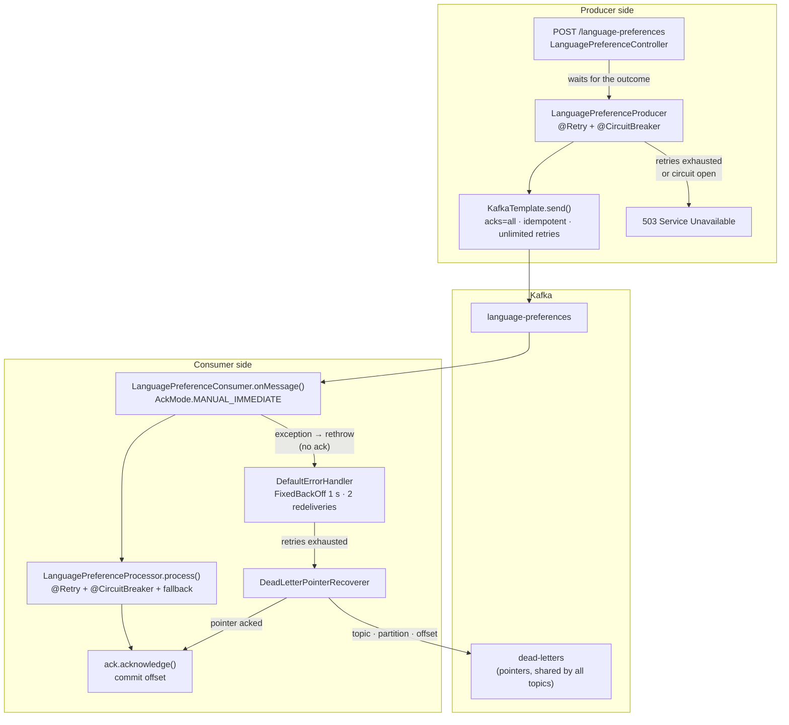
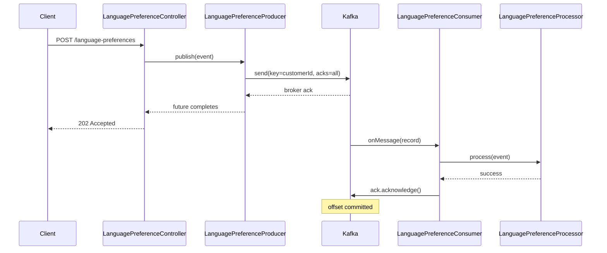
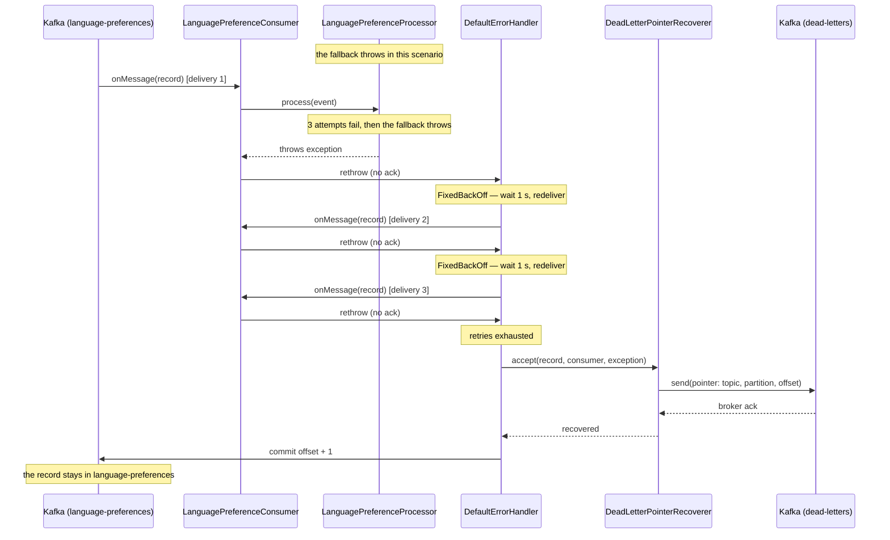
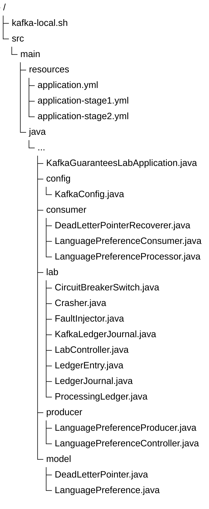

# KafkaGuaranteesLab

A Spring Boot lab that shows why Kafka's idempotent producer does not give exactly-once
delivery. The producer is idempotent with `acks=all`, the strongest guarantee a producer has
without transactions (see [Kafka transactions](#kafka-transactions)). That removes one cause of
duplicates: Kafka's own retries inside a single `send()`. Every other way to lose, skip or repeat an
event remains.

The lab lets you produce those failures on request and see the result. Each event carries an id, a
ledger records what the consumer did with it, and a fault injector makes a send, a processing
step or an offset commit go wrong. Resilience4j retries and circuit breakers sit on both sides to
show what application-level resilience adds and what it costs.

## The Problem

Kafka's guarantees each cover one hop. With an idempotent producer and `acks=all`, a record that
the broker acknowledges is stored durably, once for each call to `send()`, in the order its
partition received it. With offsets committed after processing, a consumer reads every record at
least once. Neither guarantee says that an event is processed exactly once from end to end. This
lab shows where each guarantee stops and what happens beyond it.

Two words have fixed meanings in this document:

- An event is **delivered** when the consumer's listener receives a record that carries it. Kafka
  and the listener container decide this.
- An event is **processed** when the consumer has finished its work on it. In the lab that is an
  entry in the ledger. In a real system it is a change in a database or a call to another service.

Processing is what matters to the business. A delivery that is repeated is processed again unless
the consumer prevents it, and a delivery can end without the event being processed.

### A Quick Peek Under the Covers

There are three common delivery guarantees for messages:

* *At-most-once*: a message is delivered once or not at all. The easy way to get this is to send
  the message one time and never retry.
* *At-least-once*: a message is delivered once or more. The easy way to get this is to send the
  message and retry until it is acknowledged.
* *Exactly-once*: a message is delivered once and no more. This is at-least-once and at-most-once
  together.

The two easy ways cannot be combined: one never retries and the other always does. What works is
to retry until acknowledged and then filter out the repeats. Kafka's producer does that for one
hop, from the producer to the topic:

* At-least-once comes from retrying until the broker acknowledges. `acks=all` makes the
  acknowledgment durable: all in-sync replicas persist the record before the broker acknowledges
  it, so an acknowledged record survives a broker failure.
* The filter comes from `enable.idempotence=true`. The producer gets a producer id and gives each
  record a sequence number, and the broker drops a record whose number it has already written.

Both settings are the default since Kafka 3.0. A producer that sets `enable.idempotence=true`
together with an `acks` other than `all` fails to start with a `ConfigException`.

Kafka's own exactly-once feature is the transactional producer, which builds on this one. The lab
does not use it: [Kafka transactions](#kafka-transactions) says what it would and would not change.

## Where Delivery Can Go Wrong

Three questions decide what happens to an event: was it sent, was it processed, and was it
processed only once. This section answers them in three stages. It starts with neither Kafka
idempotence nor Resilience4j, then adds idempotence, then adds Resilience4j. The lab itself runs
with both.

### Stage 1: no idempotence, no Resilience4j

Picture the application stripped down:

- The controller calls `send()` once and reports the outcome: 202 if the broker acknowledges, 503
  if the send fails.
- The producer still uses `acks=all` and Kafka's own internal retries, but
  `enable.idempotence=false`.
- The consumer calls `process()` once per delivery and commits the offset afterwards. If
  `process()` throws, the listener container redelivers the record and finally writes a
  dead-letter pointer.

#### An event might not be sent

- **The broker stays unreachable.** Kafka retries inside `send()` until `delivery.timeout.ms`
  runs out, then the send fails and the caller gets a 503. The caller holds the only copy.
- **The application stops mid-publish.** The caller sees a broken connection. Nothing in the
  application remembers the event.
- **The outcome is unknown.** A send can fail, or the HTTP response can time out, after the
  record was written. The caller cannot tell this from the two cases above.

#### An event might not be processed

- **It is dead-lettered.** A record that cannot be deserialized, or that fails every delivery,
  ends as a pointer in `dead-letters`. It is processed only if someone replays it before
  retention removes the original.
- **Retention outruns the consumer.** A record deleted before a lagging consumer reaches it is
  never read.
- **It is a tombstone.** The consumer skips records with a null value on purpose.

#### An event might be processed more than once

Two records in the topic for one event:

- **Kafka resends a batch.** The broker writes a batch, the acknowledgment is lost, and the
  producer's internal retry sends the batch again. The broker appends it a second time.
- **The caller sends the event again.** After a 503 or a broken connection the caller retries,
  but the first attempt had been written.
- **A restarted or second instance sends it again.** Whatever feeds the application replays the
  event after a restart, or two instances both publish it.

One record processed twice:

- **The offset commit is lost.** `process()` succeeds and the commit fails. Nothing is redelivered
  at that moment, and the next successful commit in the partition covers the record. If the
  consumer stops or the group rebalances before that commit, the record is delivered again.
- **The consumer stops between processing and commit.** After the restart the record is
  delivered again.
- **The group rebalances.** Records that were processed but not yet committed go to another
  consumer.
- **A delivery fails part-way.** `process()` changes something downstream and then throws. The
  redelivery repeats the change.

#### Events might arrive out of order

For this event the order matters more than the count. A preference that is processed twice leaves
the same preference behind. A preference that is processed after a newer one leaves the wrong one,
and nothing downstream shows that it is wrong.

- **A resent batch lands late.** With several requests in flight, a batch that Kafka retries can
  be written behind a batch that was sent after it.
- **An older event is sent again behind a newer one.** The caller sends a preference, then a newer
  one, then sends the first again because its outcome was unknown or its send failed. Records are
  processed in the order they were written, so the older preference overwrites the newer one.

### Stage 2: turn on idempotence

With `enable.idempotence=true` the producer gets a producer id and numbers every record it sends
to a partition. The broker remembers the last numbers it wrote for that producer
(see [A Quick Peek Under the Covers](#a-quick-peek-under-the-covers)).

This fixes two scenarios:

- **Kafka resends a batch.** The broker recognises the sequence numbers and drops the repeat.
- **A resent batch lands late.** The broker accepts a producer's batches only in sequence, so
  order within a partition is kept.

It changes none of the others:

- **Every "not sent" scenario.** Idempotence removes duplicates. It does not make a failed send
  succeed or tell the caller what happened.
- **Every "not processed" scenario.** These happen on the consumer side.
- **The caller sends the event again.** This looks like the scenario idempotence fixes, but it is
  a new call to `send()`. A new call gets a new sequence number, so to the broker it is a new
  record (see [Timeout and Retry](#timeout-and-retry)).
- **A restarted or second instance sends it again.** A new producer gets a new producer id, and
  the broker deduplicates per producer id (see
  [Boundaries after Restart](#boundaries-after-restart) and
  [Duplicate Producer Processes](#duplicate-producer-processes)).
- **Every "one record processed twice" scenario.** Idempotence covers the hop from producer to
  broker. Offset commits and redelivery are outside it.
- **An older event is sent again behind a newer one.** The order idempotence keeps is the order of
  the calls to `send()`, and the older event was sent last.

Idempotence protects one hop against one failure: a lost acknowledgment inside a single call to
`send()`.

### Stage 3: add Resilience4j

Resilience4j adds a retry and a circuit breaker on each side. They reduce how often some of the
remaining scenarios happen. They remove none of them, and they bring costs of their own.

On the producer side:

- **The broker stays unreachable** is unchanged for the caller. Kafka already retries inside one
  `send()` until `delivery.timeout.ms` runs out, 120 s by default, so it rides out a short outage
  without help. The controller answers 503 after `lab.publish.response-timeout-ms`, 10 s. The
  Resilience4j retry starts only when a `send()` has failed, which is long after the caller has
  its answer.
- **A send that fails quickly is not helped either.** It fails for a reason Kafka does not retry,
  such as a record that is too large, and a second attempt gives the same result.
- **The outcome is unknown** for longer. The 3 attempts go on in the background after the 503, each
  for up to 120 s. An event can reach the topic about 6 minutes after its caller was told it was
  not confirmed (see [How Long a Publish Can Run](#how-long-a-publish-can-run)).
- **The retry is itself a source of duplicates.** Each attempt is a new call to `send()`, exactly
  like a caller that sends the event again. If an earlier attempt was written, the topic holds
  both.
- **The retry writes events late.** While a publish waits for its next attempt, a newer event of
  the same customer can be published. The retry then writes the older event behind it. This needs
  no duplicate: the older event is written once, in the wrong place.
- **The circuit breaker sends nothing.** While the broker is down it fails publishes at once, so
  callers get a quick 503 and do not wait through timeouts. It can also reject publishes that
  would have succeeded.

On the consumer side:

- **It is dead-lettered** happens less often. The retry repeats `process()` within one delivery,
  so a brief downstream failure no longer costs a redelivery or a dead letter.
- **The retry slows the consumer.** It waits on the listener thread. Lag grows, which makes
  **retention outruns the consumer** and **the group rebalances** more likely.
- **A delivery fails part-way** is unchanged. A retry repeats a partial downstream change just as
  a redelivery does.
- **The fallback decides what happens to an event that cannot be processed.** By default it logs
  and returns, so the record is acknowledged unprocessed. That adds a way for an event to go
  unprocessed, with no dead-letter pointer. With `lab.consumer.fallback=rethrow` it throws, and
  the record goes to redelivery and the dead-letter topic
  (see [Consumer processing failures](#consumer-processing-failures)).
- **An open circuit rejects a healthy event.** The circuit breaker counts failed calls and does
  not look at the event. Once 5 of the last 10 calls have failed, it rejects every call for 30 s,
  and each rejected call goes to the fallback. By default the consumer then acknowledges every
  record it reads without processing it, including events that would have been processed. A few
  failing events cost every event that arrives in those 30 s. With
  `lab.consumer.fallback=rethrow` they are dead-lettered instead
  (see [Experiments](#experiments)).

Resilience4j does nothing for these:

- **The application stops mid-publish.**
- **The caller sends the event again** and **a restarted or second instance sends it again.**
- **The offset commit is lost** and **the consumer stops between processing and commit.**

### Summary

| Scenario | Outcome | Idempotence | Resilience4j |
|---|---|---|---|
| The broker stays unreachable | Not sent | No effect | No effect |
| The application stops mid-publish | Not sent | No effect | No effect |
| The outcome is unknown | Not sent, or sent twice | No effect | Unknown for longer |
| It is dead-lettered | Not processed | No effect | Less often |
| Retention outruns the consumer | Not processed | No effect | More likely |
| The fallback acknowledges a failed event | Not processed | No effect | New with Resilience4j |
| An open circuit rejects a healthy event | Not processed | No effect | New with Resilience4j |
| Kafka resends a batch | Processed twice | Fixed | No effect |
| The caller sends the event again | Processed twice | No effect | No effect |
| The application retries a publish | Processed twice | No effect | New with Resilience4j |
| A restarted or second instance sends it again | Processed twice | No effect | No effect |
| The offset commit is lost | Processed twice | No effect | No effect |
| The consumer stops between processing and commit | Processed twice | No effect | No effect |
| The group rebalances | Processed twice | No effect | More likely |
| A delivery fails part-way | Processed twice | No effect | No effect |
| A resent batch lands late | Out of order | Fixed | No effect |
| An older event is sent again behind a newer one | Stale overwrite | No effect | No effect |
| The application retries a publish behind a newer event | Stale overwrite | No effect | New with Resilience4j |

What is left is at-least-once delivery with gaps. Closing them takes changes outside Kafka's
producer settings:

- **Duplicates:** give every event its own id and have the consumer ignore an id it has already
  processed. That covers every "processed twice" row, whichever tier caused it, on two conditions:
    - The record of processed ids outlives the consumer. A record that is lost in a restart cannot
      recognise an event delivered again after it.
    - The id is recorded in the same atomic step as the change it guards, for example in one
      database transaction. If the id is recorded first, a failure between the two loses the
      event. If the change is made first, a failure between the two repeats it.

  The lab does this with `lab.consumer.deduplicate=true`, against its ledger. The ledger is kept
  in a Kafka topic and replayed at start, so the first condition holds. A ledger entry is both
  the change and the record of the id, so the second holds without effort. A real consumer has to
  arrange it.
- **Unprocessed events:** never acknowledge a record that was not processed. The lab does this
  with `lab.consumer.fallback=rethrow`. An event that the open circuit rejects is then
  dead-lettered. It is processed only if someone replays it.
- **Unsent events:** store the event durably before publishing, as in a transactional outbox. The
  lab does not do this. It reports the failure to the caller.
- **Stale overwrites:** give every event a version that grows with each change of a customer's
  preference, such as a sequence number or the time of the change at its source. The consumer
  ignores an event older than the one it has stored. Deduplication by event id is not enough: it
  catches a late event only if that event was already processed once. The same check is needed
  before a dead letter is replayed. The lab does not do this.

### Kafka transactions

Kafka has one mode stronger than the idempotent producer: the transactional producer. The lab does
not run it. A producer with a `transactional.id` is idempotent and adds two things:

- **Atomic writes.** The records it sends between `beginTransaction()` and `commitTransaction()`,
  to any topics and partitions, are committed together or aborted together. A consumer with
  `isolation.level=read_committed` is never given a record of an aborted transaction. The default,
  `read_uncommitted`, returns it.
- **An identity that outlasts a restart.** A new instance that starts with the same
  `transactional.id` first has the transaction its predecessor left open completed or aborted. It
  also fences the predecessor: an old instance that is still running, a "zombie", can no longer
  write under that id. A transaction left open longer than `transaction.timeout.ms` is aborted
  too. None of this recognises an event that is sent again after the restart.

In consume-process-produce, the producer also adds the offsets of the records consumed to the
transaction, with `sendOffsetsToTransaction()`. The output records and the offsets then commit or
abort together. After an abort the offsets have not moved, the input is read again, and a
`read_committed` consumer downstream never sees the output of the aborted attempt. So a record's
effect on Kafka topics happens once. A side effect outside Kafka, such as a database write or an
HTTP call, is not part of the transaction. An abort does not undo it, and the redelivery repeats it.

Applied to the rows of the [Summary](#summary):

- **Kafka resends a batch** and **a resent batch lands late** stay fixed. A transactional producer
  is idempotent.
- **The caller sends the event again**, **a restarted or second instance sends it again** and **an
  older event is sent again behind a newer one** are not changed. Two sends of one event are two
  records in two committed transactions, to a transactional producer just as to an idempotent one.
  A second instance needs its own `transactional.id`, or the two fence each other.
- **The application retries a publish** depends on where the attempt fails. If every attempt is one
  transaction and the consumer reads `read_committed`, a send that fails after its record was
  written cannot commit, and the aborted record is never delivered. But `commitTransaction()` can
  itself time out with the outcome unknown, and sending the event again after that duplicates it.
  **The application retries a publish behind a newer event** is not changed: it is still late.
- **The offset commit is lost**, **the consumer stops between processing and commit**, **the group
  rebalances** and **a delivery fails part-way** depend on what processing is. They are fixed if
  processing only writes to Kafka topics, in the transaction that carries the offsets, and a failed
  attempt aborts that transaction. They are not changed if processing has an effect outside Kafka.
  In the lab `process()` writes the ledger with a producer of its own, outside any transaction, so
  they are not changed. The ledger is a Kafka topic and could join one. The database or service it
  stands in for could not.
- Every "not sent" and "not processed" row is not changed. A transaction does not make a failed
  send succeed, and an offset committed for an unprocessed record is committed either way.

The lab leaves transactions out because its events come from an HTTP caller and end in a side
effect. Both ends are outside Kafka, where the event id and the version in the list above do the
work, with or without transactions.

### Producer-side details

The producer-side scenarios that idempotence does not fix, in more detail.

#### Timeout and Retry

The lab's producer, without its logging and fault injection:

```java
@Retry(name = "languagePreferenceProducer", fallbackMethod = "publishFallback")
@CircuitBreaker(name = "languagePreferenceProducer")
public CompletableFuture<SendResult<String, LanguagePreference>> publish(LanguagePreference event) {
    return kafkaTemplate.send(TOPIC, event.customerId(), event);
}
```

Every call to `send()` makes a new record with a new sequence number. Idempotence filters only the
repeats Kafka makes itself inside one call. When the Resilience4j retry calls `publish()` again,
the broker sees a second record and keeps it. An application retry duplicates an event in two
cases:

- **The retry races a send that is still in flight.** This happens when the application gives up
  on an attempt before Kafka does, for example by waiting on the future with
  `get(5, TimeUnit.SECONDS)` and retrying on the timeout. Kafka goes on retrying the first send
  until `delivery.timeout.ms` runs out, and it may succeed after the second was sent. There are
  two ways to avoid this: keep `delivery.timeout.ms` no larger than the application's wait for
  one attempt, or retry only when the future of the send has failed. The lab does the second.
  `publish()` returns the future, and Resilience4j retries only after it has failed.
- **The send failed although the record was written.** The request reached the broker, the
  acknowledgment was lost, and the delivery timeout ran out before a retry got through. No
  setting avoids this. The lab reproduces it with the `ambiguousSends` fault
  (see [Experiments](#experiments)).

The first case returns one tier up. `POST /language-preferences` waits 10 s for the outcome and
then answers 503 while the send is still in flight. A caller that sends the event again races it.

#### How Long a Publish Can Run

The 503 `Event not confirmed` ends the HTTP response. It does not end the publish. Nothing cancels
a publish whose caller has been answered: it goes on in the background until the broker
acknowledges the record or the last attempt fails. For all of that time the event can still reach
the topic.

These settings bound it:

| What | Bound | Set by |
|---|---|---|
| Attempts | 3 | `resilience4j.retry.instances.languagePreferenceProducer.max-attempts` |
| Wait between attempts | 1 s | `resilience4j.retry.instances.languagePreferenceProducer.wait-duration` |
| One attempt, from `send()` accepting the record to its future failing | 120 s | `lab.producer.delivery-timeout-ms`, which is Kafka's `delivery.timeout.ms` |
| One attempt, `send()` waiting for the topic's metadata before it accepts the record | 60 s | Kafka's `max.block.ms`, left at its default |

What they add up to depends on whether the producer has the topic's metadata:

- **The producer has the metadata.** This is the usual case when the broker goes down under a
  running application. `send()` accepts the record at once and Kafka tries to deliver it for
  120 s. Three attempts and two waits take 3 × 120 s + 2 × 1 s = 362 s, about 6 minutes. The record
  is written if the broker comes back at any moment in that time.
- **The producer has no metadata.** This is the case when the application has published nothing
  since it started, or nothing for 5 minutes (`metadata.max.idle.ms`), and the broker is down.
  `send()` blocks its thread for 60 s and then throws. Nothing was sent, so this attempt wrote
  nothing. Three attempts and two waits take 3 × 60 s + 2 × 1 s = 182 s, about 3 minutes. If the
  broker comes back while `send()` is blocked, the attempt goes on as in the first case.

The two can follow each other within one attempt, so the limit for one publish is
3 × (60 s + 120 s) + 2 × 1 s = 542 s, about 9 minutes. Two things end a publish sooner. An open
circuit rejects the next attempt at once, and the retry does not repeat a rejected call. Stopping
the application discards every record that is still in the producer's memory.

That limit starts when the publish starts to run, and the start can be late. A `send()` that
blocks holds a thread:

- The first attempt runs on a thread of Spring Boot's task executor, which the lab leaves at its
  defaults: 8 threads and a queue with no limit. Once 8 publishes are blocked in `send()`, every
  later publish waits in the queue. Its caller still gets 503 `Event not confirmed` after 10 s. The
  publish itself starts when a thread is free, however long that takes, and nothing removes it
  from the queue.
- The second and third attempts run on Resilience4j's retry scheduler, a second small thread pool,
  and block its threads in the same way.

So while the broker is down and the producer has no metadata, the application takes in events
faster than it gives up on them. It can go on publishing them long after the last caller was
answered. The lab does not bound this queue.

#### Signs of a Failed Send

With `acks=all`, the caller of `send()` sees one of these when a send has not been confirmed:

| What the caller sees | Was the record written? |
|---|---|
| `send()` throws, for example when serialization fails or no metadata arrives within `max.block.ms` | No. The record never left the producer |
| The future fails with an error the broker returned for the record, such as `RecordTooLargeException` | No |
| The future fails with a `TimeoutException` when `delivery.timeout.ms` runs out | Unknown |
| The caller's own `get(timeout)` gives up | Unknown. The send is still in progress |

A send that completes normally always has an offset. `RecordMetadata.hasOffset()` returns false
only for a producer with `acks=0`, which gets no response from the broker.

The lab's producer does not tell these apart. Its retry repeats the publish after any of them, and
the controller reports every failure as 503. That is why its 503 means "not confirmed" and never
"not sent".

#### Boundaries after Restart

The producer keeps unsent and unacknowledged records in memory only. When the application stops,
they are gone, and the Kafka producer sends nothing again after the restart. A duplicate after a
restart comes from whatever feeds the application:

- A caller whose connection broke sends its event again.
- A queue, an outbox table or a batch job replays the events it had not marked as done.

One of those events may have been written before the application stopped. The restarted producer
has a new producer id, so the broker cannot match the second record to the first. Idempotence
lasts for one producer session and no longer.

#### Duplicate Producer Processes

Two instances of the application each have their own producer and their own producer id. The same
event reaches both when a caller's retry is routed to the other instance, or when both read the
same source. Each instance sends it and the broker keeps both records. The broker filters repeats
within one producer id and partition, never across producers.
`LabScenarioTest.secondProducerInstance_isNotDeduplicatedByTheBroker` shows this.

## Running the Lab

### Requirements

- Java 17 or higher (Java 25 toolchain used for compilation)
- A Kafka broker on `localhost:9092`. Any broker works, because the application creates its own
  topics.
- To start a broker with the included `kafka-local.sh`: one of Apple's
  [`container`](https://github.com/apple/container) (macOS on Apple silicon),
  [`podman`](https://podman.io) or [`docker`](https://www.docker.com), installed and running. The
  script needs `bash`.

### Start

Start a local Kafka broker in KRaft mode (no ZooKeeper), then the application:

```bash
./kafka-local.sh start
./gradlew bootRun
```

The script uses the first of `container`, `podman` and `docker` that is installed and running. Set
`KAFKA_LOCAL_RUNTIME` to one of the three names to choose, for example
`KAFKA_LOCAL_RUNTIME=docker ./kafka-local.sh start`. The script does not start a runtime. If none
is running it says how to start the ones it found, for example `container system start` or
`podman machine start`, and stops. The runtimes do not share containers, so use the same one for
every command. The first start pulls the `apache/kafka` image. With `podman` and `docker` the
broker's port is published on `localhost` only.

The application creates its topics at start if they are missing: `language-preferences` and
`dead-letters` with three partitions each (`lab.topics.partitions`), and `lab-ledger` with one. It
sets no replication factor, so the broker's default applies. A topic that exists with fewer
partitions than the setting gets more, which changes the partition of its keys. A topic with more
is left as it is. The script creates the first two topics as well, with the same three partitions,
because the application looks only when it starts: a broker that is removed and started again
under a running application would otherwise auto-create them with one partition.

Without a broker the application still starts, after about 50 seconds: Spring's Kafka admin gives
up on the topics after about 40 s, and the ledger then waits `lab.ledger.timeout-ms`. It does not
look for the topics again, so start the broker first, or restart the application.

The script has four commands:

| Command | What it does |
|---|---|
| `./kafka-local.sh start` | Starts the broker. A broker that was stopped comes back with its data: topics, records, committed offsets and the ledger |
| `./kafka-local.sh stop` | Stops the broker and keeps its data |
| `./kafka-local.sh remove` | Stops the broker and deletes its data. The next `start` makes a new, empty cluster |
| `./kafka-local.sh status` | Shows whether the broker is running, stopped or absent, and lists the topics of a running one |

The commands mean the same with every runtime. The data belongs to the stopped container and there
is no named volume, so anything else that removes the container removes the data.

### Send an event and see what happened

```bash
curl -i -X POST http://localhost:8080/language-preferences \
  -H 'Content-Type: application/json' \
  -d '{"customerId": "abc123", "preferredLanguage": "fr-CA"}'
```

| Response | Meaning |
|---|---|
| 202, `Event published` | The broker acknowledged the record |
| 503, `Event not published` | The publish failed after its retries, or the circuit is open |
| 503, `Event not confirmed` | No outcome within `lab.publish.response-timeout-ms`. The send may still succeed |

Every response carries the event's id in the `Event-Id` header. An event sent without an
`eventId` gets a random one. To send the *same* event again, as a caller does when it retries,
put that id in the body: `{"eventId": "...", "customerId": "abc123", "preferredLanguage": "fr-CA"}`.

The ledger shows what the consumer did with each event:

```bash
curl http://localhost:8080/lab/ledger
# {"events":1,"processings":1,"duplicates":{},"dropped":[],"skippedDuplicates":0,"preferences":{"abc123":"fr-CA"}}
```

- `duplicates` lists the events processed more than once, with the number of times.
- `dropped` lists the events acknowledged without being processed.
- `skippedDuplicates` counts the repeats the consumer recognised and did not process.
- `preferences` gives each customer's current language: the one in the event processed last,
  which is not always the one sent last.

The ledger is kept in the `lab-ledger` topic. The application replays it at start, so it survives
a restart, and every instance of the application shows the same ledger.
`curl -X DELETE http://localhost:8080/lab/ledger` empties it for all of them.

The `/lab` endpoints are unprotected, and two of the faults stop the JVM. The application therefore
listens on `localhost` only. Start it with `--server.address=0.0.0.0` to open it to the network.

Other things to look at:

```bash
curl http://localhost:8080/actuator/circuitbreakers
curl http://localhost:8080/actuator/retries
container exec kafka-guarantees-lab-kafka /opt/kafka/bin/kafka-console-consumer.sh \
  --bootstrap-server localhost:9092 --topic dead-letters --from-beginning
```

The last command is for Apple's `container`. With another runtime, put `podman` or `docker` in its
place. `./kafka-local.sh status` names the runtime in use.

### Experiments

A fault is a count of how many more times something should go wrong. Set the faults, send an
event, then read the ledger:

```bash
curl -X POST http://localhost:8080/lab/faults \
  -H 'Content-Type: application/json' -d '{"ambiguousSends": 1}'
```

| Scenario | How to produce it | What you see |
|---|---|---|
| The application retries a publish | `{"ambiguousSends": 1}`, then send one event. The first send is written and reported as failed, and the retry sends it again | The event under `duplicates`, with 2 |
| The caller sends the event again | Send one event, then send it again with the same `eventId` | The event under `duplicates`, with 2 |
| The offset commit is lost | `{"lostCommits": 1}`, then send one event. It is processed and not acknowledged, then redelivered | The event under `duplicates`, with 2 |
| A delivery fails part-way | `{"partialFailures": 1}`, then send one event. The first attempt records the event and then fails, and the retry records it again | The event under `duplicates`, with 2 |
| The fallback acknowledges a failed event | `{"processingFailures": 3}`, then send one event. All 3 attempts fail | The event under `dropped` |
| An open circuit rejects a healthy event | `{"processingFailures": 10}`, then send 4 events and wait until all 4 are under `dropped`, about 6 s. The tenth failed call opens the circuit. Within 30 s, send a fifth event | The fifth event under `dropped` too, although no fault was left for it. `/actuator/circuitbreakers` shows `OPEN` |
| It is dead-lettered | Start with the `stage2` profile (see [Stages](#stages)). `{"processingFailures": 3}`, then send one event. All 3 deliveries fail | Nothing in the ledger, and a pointer in `dead-letters` |
| The outcome is unknown | Send one event and wait for its 202. Stop the broker with `./kafka-local.sh stop`, then send a second event for another customer: 503 `Event not confirmed` after 10 s. Within 2 minutes, start the broker again with `./kafka-local.sh start` | The second event in the ledger, under `preferences`, although its caller was told 503 |
| The consumer stops between processing and commit | `{"crashBeforeCommit": 1}`, then send one event. The application processes it and stops. Start the application again | The event under `duplicates`, with 2 |
| The application stops mid-publish | `{"crashBeforeSend": 1}`, then send one event. The application stops and `curl` reports an empty reply. Start the application again | The event is not in the ledger |
| A restarted or second instance sends it again | Start a second instance (see [A second instance](#a-second-instance)). Send one event to port 8080, then the same event with its `eventId` to port 8081 | The event under `duplicates`, with 2, on both ports |
| An older event is sent again behind a newer one | Send one event, send a second for the same customer with another language, then send the first again with its `eventId` | `preferences` shows the first language |
| An event is written late | `{"failedSends": 3}`, then send one event. All 3 attempts fail and nothing is written: 503 `Event not published`. Send a second for the same customer with another language, then the first again with its `eventId` | `preferences` shows the first language, and `duplicates` is empty |
| Duplicates closed by event id | Start with `--lab.consumer.deduplicate=true`, then repeat any of the first four | `skippedDuplicates` is 1 and `duplicates` is empty |

The dead-letter experiment uses `stage2` because that profile has no retry and no circuit breaker
in the way. With `--lab.consumer.fallback=rethrow` alone, each delivery makes 3 attempts and every
failure counts toward the consumer's circuit breaker. Enough of them open the circuit, and the
record is then dead-lettered for a rejected call and not for the injected fault. Injected
failures count toward the circuit breakers in every experiment, so check
`/actuator/circuitbreakers` if a result is not what the table says.

The open-circuit experiment takes 10 failed calls. The consumer's circuit breaker judges the last
10 calls and opens when at least 5 of them failed, but not before it has seen 10. Every attempt
counts as a call, not every event:

- The first 3 events fail 3 attempts each. That is 9 calls, and each event is dropped by the
  fallback after about 2 s.
- The first attempt of the fourth event is the tenth call. The window is full and every call in
  it failed, so the circuit opens. The second attempt is rejected, the retry does not repeat a
  rejected call, and the fourth event is dropped at once. No fault is left over.
- For the next 30 s `process()` is not called. The fifth event goes straight to the fallback and
  is acknowledged, like every other record the consumer reads in that time.

The first event after those 30 s is processed. It is one of 10 trial calls that decide whether the
circuit closes again. The events dropped meanwhile are not delivered again.

Ten failures in a row open the circuit whatever came before. Fewer are enough once the window
holds 10 calls of which 5 failed, so failures left in the window by one experiment can open the
circuit in the next. `curl http://localhost:8080/lab/faults` shows the faults still pending.

With `--lab.consumer.fallback=rethrow` the same open circuit dead-letters the events. Set
`{"processingFailures": 10}` and send 3 events. The first fails all 9 calls of its 3 deliveries and
its pointer names the injected fault. The first call for the second event is the tenth failure and
opens the circuit. The second and third events are then rejected on every delivery, and their
pointers name `CallNotPermittedException`. The third event met no fault. The ledger shows none of
the three.

In the outcome-unknown experiment the 503 says only that the wait of
`lab.publish.response-timeout-ms` is over. The record stays in the producer's memory, and Kafka
goes on trying to send it until `lab.producer.delivery-timeout-ms` runs out, 120 s later. When the
broker is back within that time, the producer reconnects and writes the record, and the application
logs `Published event` for an event whose caller was answered 503 some time before. Three points
about running it:

- **The broker must keep its data.** `./kafka-local.sh stop` keeps it. The ledger is itself a
  Kafka topic, and so are the consumer's committed offsets. After `./kafka-local.sh remove` the
  next `start` makes an empty cluster: the ledger is gone, the lab's topics are new, and the result
  is not the one in the table.
- **The first event is there to load the producer's metadata.** Without it the experiment ends the
  same way by another route: `send()` blocks until the broker is back, and then sends.
- **A broker that comes back later still gets the event,** as long as an attempt is still running.
  [How Long a Publish Can Run](#how-long-a-publish-can-run) gives the limits.

To add the caller's retry to the experiment, send the second event again with its `eventId` while
the broker is down. Both sends wait in the producer, both are written when the broker is back, and
the event appears under `duplicates`, with 2.

The `lostCommits` fault fails the delivery after `process()` has returned, and the error handler
redelivers the record after its backoff. That is what a consumer sees after it stopped between processing
and commit and was restarted. A commit that merely fails redelivers nothing until such a restart
or a rebalance. Each lost commit also uses up one delivery: with `{"lostCommits": 3}` the event is
processed 3 times and then dead-lettered.

In the `stage1` and `stage2` profiles there is no retry, and the part-way failure is repeated by
the redelivery instead. With deduplication on it is not repeated at all, because the lab's ledger
entry is the change and the record of the id in one step. A consumer that makes the change and
records the id in two steps can still fail between them.

The two stale-overwrite rows end the same way for different reasons. In the first, the older event is
processed twice, and `--lab.consumer.deduplicate=true` puts it right by skipping the repeat. In the
second it is processed once, after the newer one, and deduplication changes nothing.
`LabDeduplicationTest` shows the application's own retry doing the same without the caller's help.

The two crash faults halt the JVM with no shutdown, as a killed process stops. `./gradlew bootRun`
reports this as a failed build. The faults are held in memory, so the restarted application has
none pending. With `--lab.consumer.deduplicate=true` on the restart, the event that was processed
before the crash is recognised from the replayed ledger and skipped.

Pass a setting on the command line like this:

```bash
./gradlew bootRun --args='--lab.consumer.deduplicate=true'
```

`LabScenarioTest`, `LabDeduplicationTest`, `LabStageOneTest`, `LabRestartTest`,
`OutcomeUnknownTest`, `ConsumerOpenCircuitTest` and `ConsumerOpenCircuitRethrowTest` run these
experiments automatically. `LabRestartTest` starts and stops
application instances against one broker. It cannot halt its own JVM, so its crash ends the
thread concerned and leaves the record unacknowledged. `OutcomeUnknownTest` does not stop the
broker. It holds the produce request in the proxy described under [Stages](#stages) until the
caller has its 503, then lets it through.

### Stages

The three stages of [Where Delivery Can Go Wrong](#where-delivery-can-go-wrong) can each be
started. Without a profile the application runs stage 3.

| Stage | Start with | Idempotence | Retries and circuit breakers |
|---|---|---|---|
| 1 | `./gradlew bootRun --args='--spring.profiles.active=stage1'` | Off | Off |
| 2 | `./gradlew bootRun --args='--spring.profiles.active=stage2'` | On | Off |
| 3 | `./gradlew bootRun` | On | On |

In stages 1 and 2 a retry has one attempt, the circuit breakers are disabled, and a processing
failure goes straight to redelivery and the dead-letter topic.

Stage 1 and stage 2 differ in one scenario only, **Kafka resends a batch**, and it takes a network
fault to produce it. `LostAcknowledgmentTest` does so. It puts a small TCP proxy between the
application and the broker. The proxy lets one produce request through, and when the broker's
acknowledgment comes back it closes the producer's connection instead of forwarding it. Kafka's
producer then sends the batch again:

| Profile | Records in the topic | Times the event is processed |
|---|---|---|
| `stage1` | 2 | 2 |
| `stage2` | 1 | 1 |

In both runs the call to `send()` succeeds, and nothing tells the application that a batch was
sent twice. Run it with `./gradlew test --tests "*LostAcknowledgmentTest"`.

### A second instance

A second instance of the application joins the same consumer group and shares the ledger:

```bash
./gradlew bootRun --args='--server.port=8081'
```

The three partitions are divided between the two instances. Each has its own producer, with its
own producer id. Stop one with `crashBeforeCommit` and the other takes over its partitions once
the session timeout of 45 s has passed, then processes the uncommitted record again.

### What the lab cannot reproduce

Some scenarios need a fault outside the application, and the lab does not create them:

- **Kafka resends a batch**, by hand. The proxy that loses an acknowledgment is part of the tests
  (see [Stages](#stages)), and the broker has to advertise the proxy's address. A tool such as
  Toxiproxy in front of the local broker would do the same for a manual run.
- **A resent batch lands late.** Closing the connection fails every batch in flight, and the
  producer sends them again in their original order. A reorder needs the broker to reject one
  batch with a retriable error and accept the next, which the proxy cannot make it do.
- **The group rebalances.** A second instance that joins or leaves duplicates nothing here,
  because the listener commits each record before it reads the next. A duplicate needs a consumer
  that still holds a processed, uncommitted record when the group takes its partition away. That
  happens when processing takes longer than `max.poll.interval.ms`, and the lab has no fault that
  stalls processing for that long.
- **Retention outruns the consumer.** This needs a topic with a short retention and a consumer
  that is held back.

### Stop

```bash
./kafka-local.sh stop        # stop the broker and keep its data
./kafka-local.sh remove      # or: stop the broker and delete its data
```

Both use the runtime that `start` used, as long as it is still the first one running or
`KAFKA_LOCAL_RUNTIME` names it. Neither stops the runtime itself.

After `stop`, the next `start` brings back the same cluster, with the ledger and the committed
offsets as they were. Use `remove` to start again from an empty cluster.

## Architecture

### Delivery guarantee layers

The lab aims at at-least-once delivery in two independent layers. The Kafka broker protocol
handles durability on the producer side. Manual offset management handles redelivery on the
consumer side. Resilience4j adds application-level retry and circuit breaking on top of both. With
the default fallback the consumer side falls short of at-least-once: see
[Consumer processing failures](#consumer-processing-failures).



### Sequence: successful delivery



### Sequence: consumer failure and dead-letter pointer



The diagram shows a delivery that fails. With the default fallback, a processing failure does
not get this far: see [Consumer processing failures](#consumer-processing-failures). Deliveries
fail when the fallback throws (`lab.consumer.fallback=rethrow`), when the acknowledgment fails, or
when a payload cannot be deserialized.

### Consumer processing failures

`LanguagePreferenceConsumer.onMessage()` hands each event to
`LanguagePreferenceProcessor.process()`. That is where a real implementation would make its
downstream calls, such as a database write or an HTTP request. Everything in it runs on the
consumer thread, in the call stack of `onMessage()`. A processing failure passes through three
stages:

1. **Resilience4j retry.** `process()` is attempted up to 3 times within one delivery, 1 s apart.
   The consumer thread waits in between, and nothing else is read from the partition.
2. **Fallback.** When every attempt has failed, `processFallback()` runs. What it does is set by
   `lab.consumer.fallback`. When the circuit is open, `process()` is not called and the fallback
   runs at once: the retry does not repeat a call that the circuit breaker rejected.
3. **Redelivery and dead-lettering.** These apply only if an exception reaches `onMessage()`,
   which for a processing failure means the fallback threw.

The two fallback settings are a choice between progress and the delivery guarantee:

- **`acknowledge`, the default.** The fallback logs the error and returns, and `onMessage()`
  acknowledges the record. An event that cannot be processed is dropped. It is neither
  redelivered nor dead-lettered, and the error log and the ledger's `dropped` list are the only
  traces of it.
- **`rethrow`.** The fallback throws. The record is redelivered and, after the redeliveries are
  exhausted, gets a dead-letter pointer. Each redelivery repeats the 3 attempts, so a record is
  tried up to 9 times before it is dead-lettered, and its partition waits meanwhile.

The fallback cannot tell an event that failed from one that the open circuit rejected, and treats
both alike. While the circuit is open, `acknowledge` drops every event the consumer reads, and
`rethrow` dead-letters every one of them after 3 rejected deliveries. Either way a healthy event
is not processed (see [Experiments](#experiments)).

A record with a null value (a tombstone) carries no preference. The consumer acknowledges it
without processing it and without dead-lettering it.

### Dead-letter pointers

A conventional dead-letter topic holds a full copy of each failed record, usually in one topic per
source topic. This lab keeps one shared `dead-letters` topic and writes only a pointer to the
failed record:

```json
{
  "topic": "language-preferences",
  "partition": 0,
  "offset": 42,
  "timestamp": 1794856800000,
  "consumerGroup": "kafka-guarantees-lab-group",
  "exceptionClass": "java.lang.IllegalStateException",
  "exceptionMessage": "downstream unavailable"
}
```

The pointer never reads the payload, so the same recoverer and the same topic work for any source
topic and any payload type. Customer data is not duplicated into a second topic with its own
retention and access rules.

#### Wiring

- `KafkaConfig.kafkaListenerContainerFactory()` builds the `DefaultErrorHandler` with two
  arguments: the `DeadLetterPointerRecoverer` and the `FixedBackOff`. The error handler redelivers
  a failed record until the backoff is exhausted, then calls the recoverer.
- `DeadLetterPointerRecoverer` implements Spring Kafka's `ConsumerAwareRecordRecoverer`. It gets
  the failed `ConsumerRecord`, the `Consumer` and the exception. It reads the coordinates from the
  record, the group from the consumer and the root cause from the exception.
- The pointer is sent through its own `KafkaTemplate<String, DeadLetterPointer>`, built from the
  same producer settings as the events (`acks=all`, idempotent). The key is
  `<source topic>-<source partition>`, so pointers into one source partition stay in offset order.
- The recoverer blocks on the send for up to `lab.dead-letter.send-timeout-ms`.
  If the send fails or times out, the recoverer throws. `DefaultErrorHandler` treats that as a
  failed recovery and redelivers the source record with a fresh set of retries.
- `setCommitRecovered(true)` makes the error handler commit the offset after a successful
  recovery. With a manual ack mode the container does not do this on its own.

- The consumer's value deserializer is `ErrorHandlingDeserializer` wrapping
  `JacksonJsonDeserializer`. A payload that cannot be deserialized would otherwise fail inside
  `poll()`, where the error handler has no record to recover, and the consumer would retry the
  same offset in a tight loop. With the wrapper, the failure reaches the error handler as a
  `DeserializationException`. That exception is not retried: the pointer is written at once and
  the record never reaches the listener.

The order is therefore always: pointer acknowledged, then offset committed. A crash between the
two redelivers the record, never loses it.

#### Catches

- **A pointer expires with its source.** Once retention or compaction removes the original
  record, the pointer dangles. The retention of the source topic is the deadline for dealing with
  its dead letters. On a compacted topic, a newer record with the same key removes the failed one.
- **Replay needs a seek.** A tool that reprocesses dead letters cannot simply consume
  `dead-letters`. For each pointer it must assign the source partition, seek to the offset and
  read one record. `LanguagePreferenceConsumerDeadLetterTest.readSource()` shows this.
- **Pointers can be duplicated.** A pointer send that times out may still succeed, and the record
  is then redelivered and dead-lettered again. Pointers are at-least-once, like everything else
  here. Treat (topic, partition, offset) as the identity of a dead letter.
- **A failing pointer write blocks the partition.** While `dead-letters` cannot be written, the
  failed record is redelivered indefinitely and nothing behind it in the partition is consumed.
  This is the price of never skipping a record without a pointer.
- **The exception message is copied.** Keep payload data out of exception messages, or the
  pointer carries it after all. Deserialization failures are the exception: a parser's message
  quotes the bytes it could not read, so the pointer records the fixed text
  `payload could not be deserialized` and the class of the root cause.
- **The topic must exist.** The application declares `dead-letters` and creates it at start if it
  is missing. A consumer that uses this recoverer elsewhere must create the topic or rely on the
  broker's topic auto-creation.

### Why the producer has no dead-letter store

A dead-letter topic on the producer side would sit on the same Kafka cluster as the main topic.
When publishes fail because the cluster is unreachable, a write to a dead-letter topic fails for
the same reason. It could only help with failures specific to one record or one topic, such as an
oversized record or a missing topic.

So the producer stores nothing and reports the failure. `LanguagePreferenceController` waits for
the publish outcome, for at most `lab.publish.response-timeout-ms`, and responds 503 Service
Unavailable when the publish fails after its retries, the circuit is open, or the outcome is not
known in time. The caller still holds the event and decides whether to retry.

- A 503 does not prove the event was not written. When the outcome is not known in time, the
  response is 503 `Event not confirmed` while the send is still in progress. A caller that
  retries can then publish a duplicate, unless it repeats the event's id and the consumer
  deduplicates. This is the [Timeout and Retry](#timeout-and-retry) failure mode, one tier up.
- A system that must accept events while Kafka is down needs a durable store outside Kafka, such
  as a transactional outbox. That is outside this lab.

## Configuration reference

### Kafka producer

| Setting | Value | Purpose |
|---|---|---|
| `acks` | `all` | All in-sync replicas must acknowledge before the send completes |
| `enable.idempotence` | `true` | Prevents duplicate records from broker-level retries. Set by `lab.producer.idempotence` |
| `retries` | `Integer.MAX_VALUE` | Retries transient errors until `delivery.timeout.ms` elapses; the time bound, not the count, limits retries |
| `delivery.timeout.ms` | `120000` | Upper bound on a single send, from the moment `send()` accepts the record, including all internal retries. Set by `lab.producer.delivery-timeout-ms`. The value is Kafka's default |
| `max.block.ms` | `60000` (default) | How long `send()` blocks while it waits for the topic's metadata; not set in `KafkaConfig` |
| `max.in.flight.requests.per.connection` | `5` | Maximum allowed with idempotence enabled |

### Kafka consumer

| Setting | Value | Purpose |
|---|---|---|
| `enable.auto.commit` | `false` | Offset committed manually after successful processing only |
| `auto.offset.reset` | `earliest` | No committed offset on first start — consume from the beginning |
| `AckMode` | `MANUAL_IMMEDIATE` | Commits immediately when `ack.acknowledge()` is called |

### Resilience4j

Both the producer and consumer have independent instances configured in `application.yml`.

#### Circuit breaker defaults

| Instance | Failure threshold | Slow call threshold | Slow duration | Wait in open |
|---|---|---|---|---|
| `languagePreferenceProducer` | 50% | 80% | 2 s | 30 s |
| `languagePreferenceConsumer` | 50% | — | — | 30 s |

Both instances use a count-based sliding window of 10 calls. A circuit does not open before its
window holds 10 calls. The producer permits 3 calls in the
half-open state; the consumer leaves this at the Resilience4j default of 10.

#### Retry defaults

Both instances: 3 attempts, 1 s fixed wait, retries on any `Exception` except
`CallNotPermittedException`. A call that an open circuit rejects is not repeated. A publish fails
at once while the producer's circuit is open, and a record read while the consumer's circuit is
open goes to the fallback at once.

A producer attempt lasts as long as one `send()`, which Kafka bounds with `delivery.timeout.ms`.
The 3 attempts and 2 waits can therefore take about 6 minutes, and they continue after
`POST /language-preferences` has answered 503
(see [How Long a Publish Can Run](#how-long-a-publish-can-run)).

Each fallback is declared on `@Retry`, the outer of the two annotations, so it runs once after
the last attempt and not once per attempt. It also runs for a call that the retry does not
repeat, such as one rejected by the open circuit.

### DefaultErrorHandler

`FixedBackOff(1 s, 2 attempts)` — up to 2 redeliveries (3 deliveries in total) before a pointer to
the message is written to the dead-letter topic. This operates at the Kafka listener container
layer, around the Resilience4j retry inside `LanguagePreferenceProcessor.process()`, and only for
exceptions that reach `onMessage()`.

| Setting | Value | Purpose |
|---|---|---|
| `lab.consumer.redelivery.interval-ms` | `1000` | Wait between redeliveries |
| `lab.consumer.redelivery.max-attempts` | `2` | Redeliveries after the first delivery |
| `lab.dead-letter.topic` | `dead-letters` | Shared topic for dead-letter pointers |
| `lab.dead-letter.send-timeout-ms` | `10000` | How long the recoverer waits for the pointer to be acknowledged |
| `commitRecovered` | `true` | Commit the offset once the pointer is written |

### Lab switches

The application's own settings live under `lab.*` in `application.yml`. They are not Spring Boot
properties.

| Setting | Default | Purpose |
|---|---|---|
| `lab.producer.idempotence` | `true` | Kafka's idempotent producer. Off in the `stage1` profile |
| `lab.producer.delivery-timeout-ms` | `120000` | Kafka's `delivery.timeout.ms`: how long one `send()` goes on trying before it fails. It applies to events and to dead-letter pointers. Kafka requires at least `linger.ms` + `request.timeout.ms`, which is 30005 with the defaults used here. A lower value makes every send fail with a `ConfigException` |
| `lab.circuit-breakers.enabled` | `true` | Off in the `stage1` and `stage2` profiles |
| `lab.consumer.fallback` | `acknowledge` | `acknowledge` drops an event that cannot be processed. `rethrow` sends it to redelivery and the dead-letter topic |
| `lab.consumer.deduplicate` | `false` | Skip an event whose id was already processed |
| `lab.publish.response-timeout-ms` | `10000` | How long `POST /language-preferences` waits for the publish outcome |
| `lab.topics.partitions` | `3` | Partitions of `language-preferences` and `dead-letters`. The application creates the topics at start if they are missing, and adds partitions to one that has fewer |
| `lab.ledger.topic` | `lab-ledger` | Topic that holds the ledger. The application creates it with one partition |
| `lab.ledger.timeout-ms` | `10000` | How long to wait for the ledger's replay at start, and for each entry to be written and read back |
| `server.address` | `localhost` | A Spring Boot property. The lab sets it because the `/lab` endpoints are unprotected |

## Layout



## Technologies

Java, Gradle, Spring Boot, Spring Kafka, Resilience4j, Micrometer with Prometheus, and JaCoCo.
The versions are declared in `gradle/libs.versions.toml` and
`gradle/wrapper/gradle-wrapper.properties`. Spring Boot's dependency management sets the versions
of Spring Kafka, the Kafka client and Micrometer.

## Links

- [GitHub repository](https://github.com/bhanafee/KafkaGuaranteesLab)
- [Javadoc](https://bhanafee.github.io/KafkaGuaranteesLab/javadoc/)
- [Test Results](https://bhanafee.github.io/KafkaGuaranteesLab/tests/)
- [Coverage Report](https://bhanafee.github.io/KafkaGuaranteesLab/coverage/)
- [Code of Conduct](https://bhanafee.github.io/KafkaGuaranteesLab/CODE_OF_CONDUCT.html)
- [Agents guidance](https://bhanafee.github.io/KafkaGuaranteesLab/AGENTS.html)

[](LICENSE)
