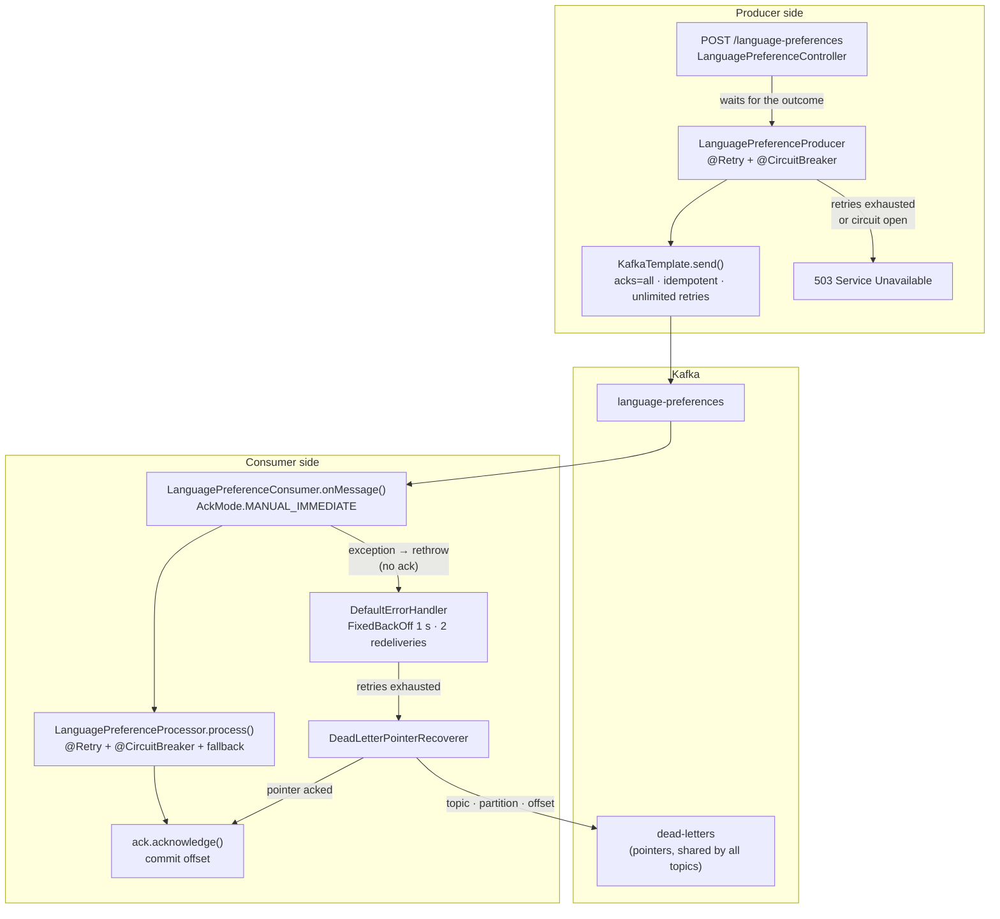
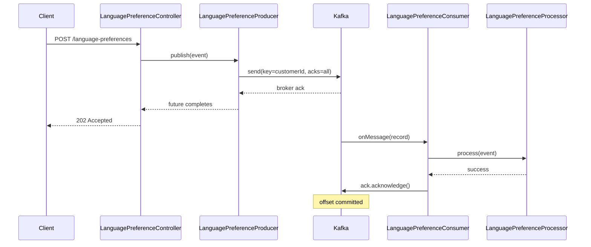
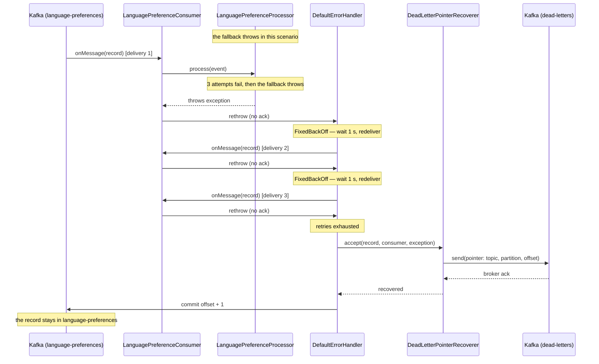
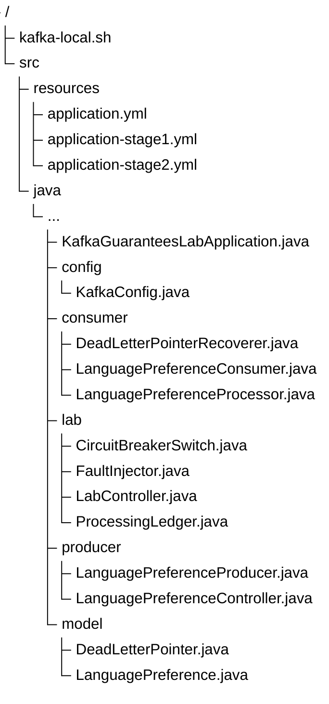

# KafkaGuaranteesLab

A Spring Boot lab that shows why Kafka's idempotent producer does not give exactly-once
delivery. Kafka is configured for its strongest producer guarantee, an idempotent producer with
`acks=all`. That removes one cause of duplicates: Kafka's own retries inside a single `send()`.
Every other way to lose, skip or repeat an event remains.

The lab lets you produce those failures on request and see the result. Each event carries an id, a
ledger records what the consumer did with it, and a fault injector makes a send, a processing
step or an offset commit go wrong. Resilience4j retries and circuit breakers sit on both sides to
show what application-level resilience adds and what it costs.

## The Problem

Kafka provides strong delivery and ordering guarantees for applications that follow the API contract. Under most
conditions, every message is processed exactly once and in the same order by both producer and consumer. However,
developers need to be aware of the boundaries and plan for failures. This lab shows where those boundaries are and what happens beyond them.

### A Quick Peek Under the Covers

To understand where things can go awry, it's helpful to understand what happens when things go right. There are
three common delivery guarantees for messages:

* *At-most-once* guarantees that a message is delivered either once or not at all. Conceptually, the easiest way to
  ensure this is to try to send the message one time and never retry.
* *At-least-once* guarantees that a message is delivered at least once, but maybe more. Conceptually, the
  easiest way to ensure this is to send the message and retry until it is acknowledged.
* *Exactly-once* guarantees that a message is delivered once and no more. Conceptually, this is the same
  as simultaneously guaranteeing both at-least-once *and* at-most-once.

Obviously, you can't get exactly-once by using the easy approaches to at-most-once and at-least-once at the same time.
What you can do instead is use retries as needed to ensure at least once delivery, then filter duplicates. Duplicates
can happen when the sender retries while the receiver is down, or when the receiver is slow to process
messages. Kafka implements a limited exactly-once guarantee by doing just that:

* At-least-once comes from retrying until the broker acknowledges. `acks=all` makes that acknowledgement
  durable: each message is persisted by all in-sync replicas before the broker acks, so an acked message
  survives a broker failure.
* The at-most-once half, suppressing duplicates from those retries, comes from `enable.idempotence=true`,
  which has Kafka assign a unique key (producer ID + sequence number) to each message so the broker can drop a
  replayed one.

Both `acks=all` and `enable.idempotence=true` have been default Kafka settings since 3.0.0. In addition, if
idempotence is enabled, Kafka will automatically require `acks=all` for durable writes.

## Where Delivery Can Go Wrong

Three questions decide what happens to an event: was it sent, was it processed, and was it
processed only once. This section answers them in three stages. It starts with neither Kafka
idempotence nor Resilience4j, then adds idempotence, then adds Resilience4j. The lab itself runs
with both.

### Stage 1: no idempotence, no Resilience4j

Picture the application stripped down:

- The controller calls `send()` once and reports the outcome: 202 if the broker acknowledges, 503
  if the send fails.
- The producer still uses `acks=all` and Kafka's own internal retries, but
  `enable.idempotence=false`.
- The consumer calls `process()` once per delivery and commits the offset afterwards. If
  `process()` throws, the listener container redelivers the record and finally writes a
  dead-letter pointer.

#### An event might not be sent

- **The broker stays unreachable.** Kafka retries inside `send()` until `delivery.timeout.ms`
  runs out, then the send fails and the caller gets a 503. The caller holds the only copy.
- **The application stops mid-publish.** The caller sees a broken connection. Nothing in the
  application remembers the event.
- **The outcome is unknown.** A send can fail, or the HTTP response can time out, after the
  record was written. The caller cannot tell this from the two cases above.

#### An event might not be processed

- **It is dead-lettered.** A record that cannot be deserialized, or that fails every delivery,
  ends as a pointer in `dead-letters`. It is processed only if someone replays it before
  retention removes the original.
- **Retention outruns the consumer.** A record deleted before a lagging consumer reaches it is
  never read.
- **It is a tombstone.** The consumer skips records with a null value on purpose.

#### An event might be processed more than once

Two records in the topic for one event:

- **Kafka resends a batch.** The broker writes a batch, the acknowledgment is lost, and the
  producer's internal retry sends the batch again. The broker appends it a second time.
- **The caller sends the event again.** After a 503 or a broken connection the caller retries,
  but the first attempt had been written.
- **A restarted or second instance sends it again.** Whatever feeds the application replays the
  event after a restart, or two instances both publish it.

One record processed twice:

- **The offset commit is lost.** `process()` succeeds, the commit fails, and the record is
  delivered again.
- **The consumer stops between processing and commit.** After the restart the record is
  delivered again.
- **The group rebalances.** Records that were processed but not yet committed go to another
  consumer.
- **A delivery fails part-way.** `process()` changes something downstream and then throws. The
  redelivery repeats the change.

#### Events might arrive out of order

- **A resent batch lands late.** With several requests in flight, a batch that Kafka retries can
  be written behind a batch that was sent after it.

### Stage 2: turn on idempotence

With `enable.idempotence=true` the producer gets a producer id and numbers every record it sends
to a partition. The broker remembers the last numbers it wrote for that producer
(see [A Quick Peek Under the Covers](#a-quick-peek-under-the-covers)).

This fixes two scenarios:

- **Kafka resends a batch.** The broker recognises the sequence numbers and drops the repeat.
- **A resent batch lands late.** The broker accepts a producer's batches only in sequence, so
  order within a partition is kept.

It changes none of the others:

- **Every "not sent" scenario.** Idempotence removes duplicates. It does not make a failed send
  succeed or tell the caller what happened.
- **Every "not processed" scenario.** These happen on the consumer side.
- **The caller sends the event again.** This looks like the scenario idempotence fixes, but it is
  a new call to `send()`. A new call gets a new sequence number, so to the broker it is a new
  record (see [Timeout and Retry](#timeout-and-retry)).
- **A restarted or second instance sends it again.** A new producer gets a new producer id, and
  the broker deduplicates per producer id (see
  [Boundaries after Restart](#boundaries-after-restart) and
  [Duplicate Producer Processes](#duplicate-producer-processes)).
- **Every "one record processed twice" scenario.** Idempotence covers the hop from producer to
  broker. Offset commits and redelivery are outside it.

Idempotence protects one hop against one failure: a lost acknowledgment inside a single call to
`send()`.

### Stage 3: add Resilience4j

Resilience4j adds a retry and a circuit breaker on each side. They reduce how often some of the
remaining scenarios happen. They remove none of them, and they bring costs of their own.

On the producer side:

- **The broker stays unreachable** happens less often. The retry repeats a failed publish up to 3
  times, so a short outage no longer reaches the caller as a 503. A longer one still does.
- **The retry is itself a source of duplicates.** Each attempt is a new call to `send()`, exactly
  like a caller that sends the event again. If an earlier attempt was written, the topic holds
  both.
- **The circuit breaker sends nothing.** While the broker is down it fails publishes at once, so
  callers get a quick 503 and do not wait through timeouts. It can also reject publishes that
  would have succeeded.

On the consumer side:

- **It is dead-lettered** happens less often. The retry repeats `process()` within one delivery,
  so a brief downstream failure no longer costs a redelivery or a dead letter.
- **The retry slows the consumer.** It waits on the listener thread. Lag grows, which makes
  **retention outruns the consumer** and **the group rebalances** more likely.
- **A delivery fails part-way** is unchanged. A retry repeats a partial downstream change just as
  a redelivery does.
- **The fallback decides what happens to an event that cannot be processed.** By default it logs
  and returns, so the record is acknowledged unprocessed. That adds a way for an event to go
  unprocessed, with no dead-letter pointer. With `lab.consumer.fallback=rethrow` it throws, and
  the record goes to redelivery and the dead-letter topic
  (see [Consumer processing failures](#consumer-processing-failures)).

Resilience4j does nothing for these:

- **The application stops mid-publish** and **the outcome is unknown.**
- **The caller sends the event again** and **a restarted or second instance sends it again.**
- **The offset commit is lost** and **the consumer stops between processing and commit.**

### Summary

| Scenario | Outcome | Idempotence | Resilience4j |
|---|---|---|---|
| The broker stays unreachable | Not sent | No effect | Less often |
| The application stops mid-publish | Not sent | No effect | No effect |
| The outcome is unknown | Not sent, or sent twice | No effect | No effect |
| It is dead-lettered | Not processed | No effect | Less often |
| Retention outruns the consumer | Not processed | No effect | More likely |
| The fallback acknowledges a failed event | Not processed | No effect | New with Resilience4j |
| Kafka resends a batch | Processed twice | Fixed | No effect |
| The caller sends the event again | Processed twice | No effect | No effect |
| The application retries a publish | Processed twice | No effect | New with Resilience4j |
| A restarted or second instance sends it again | Processed twice | No effect | No effect |
| The offset commit is lost | Processed twice | No effect | No effect |
| The consumer stops between processing and commit | Processed twice | No effect | No effect |
| The group rebalances | Processed twice | No effect | More likely |
| A delivery fails part-way | Processed twice | No effect | No effect |
| A resent batch lands late | Out of order | Fixed | No effect |

What is left is at-least-once delivery with gaps. Closing them takes changes outside Kafka's
producer settings:

- **Duplicates:** give every event its own id and have the consumer ignore an id it has already
  processed. That covers every "processed twice" row, whichever tier caused it. The lab does this
  with `lab.consumer.deduplicate=true`, against an in-memory ledger.
- **Unprocessed events:** never acknowledge a record that was not processed. The lab does this
  with `lab.consumer.fallback=rethrow`.
- **Unsent events:** store the event durably before publishing, as in a transactional outbox. The
  lab does not do this. It reports the failure to the caller.

### Producer-side details

The producer-side scenarios that idempotence does not fix, in more detail.

#### Timeout and Retry

Suppose a producer application has this code, where `producer` is a `KafkaProducer<String, Foo>`:

```java
public void send(ProducerRecord<String, Foo> record) throws InterruptedException {
    producer.send(record);
    Thread.sleep(5);
    producer.send(record);       // Send the same record again
}
```

Kafka would send the first message, wait 5 milliseconds, then send a second message with exactly the same contents.
Kafka will view this as two separate messages. Each will be assigned a unique sequence number, and both will be delivered.

Now consider a producer application that gives each attempt 5 milliseconds and retries with Resilience4j:

```java
@Retry(name = "send")
public void send(ProducerRecord<String, Foo> record) throws Exception {
    producer.send(record).get(5, TimeUnit.MILLISECONDS);   // give up on this attempt after 5 ms
}
```

If the first attempt times out (5ms is way too short), the retry will be triggered. But the first attempt might yet
succeed even after the retry. As before, Kafka would send the same message twice with different sequence numbers.
You can mitigate this failure by ensuring Kafka's internal retry loop finishes before the application retries.
Enabling idempotence requires `retries` > 0. The critical setting is `delivery.timeout.ms`, which bounds the
whole send including internal retries. Keep it *no larger* than the application's per-attempt timeout, or simply
gate the application retry on the `send()` future completing. Idempotence dedups only Kafka's own retries. A
fresh application-level `send()` gets a new sequence number and is not filtered.

This lab takes the second mitigation. `LanguagePreferenceProducer.publish()` returns the future of the send, and
Resilience4j retries only after that future has failed, so a retry never races a send that is still in flight.
What remains is a send that reports failure although its record was written. The lab reproduces exactly that
with the `ambiguousSends` fault (see [Experiments](#experiments)).

#### Exception on Send

The producer might throw an exception or otherwise indicate failure on a `send()` call.

* `producer.send()` throws an exception
* On the Future returned by `send()`:
    * Any method throws an exception, including if `get(timeout)` times out
    * `isCancelled()` returns true
* On the `RecordMetadata` returned by `send().get()`:
    * `hasOffset()` or `hasTimestamp()` returns false
    * `offset()`, `timestamp()` or `partition()` returns -1
 
In most cases, the failure means the producer did not send the message successfully. However, there are a few cases
where the message did get sent despite the failure. Retries from the application tier *may* send duplicate messages
in those cases.

**Tip:** These types of failures may indicate a problem with the producer configuration. Pay particular attention to
the `acks`, `retries`, `delivery.timeout.ms` and `max.in.flight.requests.per.connection` settings.

#### Boundaries after Restart

If a producer application crashes after sending a message but before the broker acknowledges the receipt or before the
receipt is recorded by the producer, the message may be delivered again when the application restarts. This can lead to
duplicate messages. After restart, the producer will be assigned a new PID. Any message delivered before the
crash but un-acked (network loss, timeout) will be re-sent under the new PID — the broker has no way
to recognise it as a duplicate. Idempotence is per-session, not durable across process lifetimes.

#### Duplicate Producer Processes

While outside the realm of Kafka, if multiple producer instances share the same logical role then each will have a
different PID. The broker deduplicates per-PID, so each instance will send its own messages. This can lead to duplicate
messages if the same event is published by multiple instances.

## Running the Lab

### Requirements

- Java 17 or higher (Java 25 toolchain used for compilation)
- A Kafka broker on `localhost:9092`. The included `kafka-local.sh` starts one in a container,
  using `container`, `podman` or `docker`, whichever it finds first.

### Start

Start a local Kafka broker in KRaft mode (no ZooKeeper), then the application:

```bash
./kafka-local.sh start
./gradlew bootRun
```

### Send an event and see what happened

```bash
curl -i -X POST http://localhost:8080/language-preferences \
  -H 'Content-Type: application/json' \
  -d '{"customerId": "abc123", "preferredLanguage": "fr-CA"}'
```

| Response | Meaning |
|---|---|
| 202, `Event queued` | The broker acknowledged the record |
| 503, `Event not published` | The publish failed after its retries, or the circuit is open |
| 503, `Event not confirmed` | No outcome within `lab.publish.response-timeout-ms`. The send may still succeed |

Every response carries the event's id in the `Event-Id` header. An event sent without an
`eventId` gets a random one. To send the *same* event again, as a caller does when it retries,
put that id in the body: `{"eventId": "...", "customerId": "abc123", "preferredLanguage": "fr-CA"}`.

The ledger shows what the consumer did with each event:

```bash
curl http://localhost:8080/lab/ledger
# {"events":1,"processings":1,"duplicates":{},"dropped":[],"skippedDuplicates":0}
```

- `duplicates` lists the events processed more than once, with the number of times.
- `dropped` lists the events acknowledged without being processed.
- `skippedDuplicates` counts the repeats the consumer recognised and did not process.

The ledger is in memory and starts empty with the application.
`curl -X DELETE http://localhost:8080/lab/ledger` empties it. The `/lab` endpoints are unprotected
and are for the lab only.

Other things to look at:

```bash
curl http://localhost:8080/actuator/circuitbreakers
curl http://localhost:8080/actuator/retries
kafka-console-consumer --bootstrap-server localhost:9092 --topic dead-letters --from-beginning
```

### Experiments

A fault is a count of how many more times something should go wrong. Set the faults, send an
event, then read the ledger:

```bash
curl -X POST http://localhost:8080/lab/faults \
  -H 'Content-Type: application/json' -d '{"ambiguousSends": 1}'
```

| Scenario | How to produce it | What you see |
|---|---|---|
| The application retries a publish | `{"ambiguousSends": 1}`, then send one event. The first send is written and reported as failed, and the retry sends it again | The event under `duplicates`, with 2 |
| The caller sends the event again | Send one event, then send it again with the same `eventId` | The event under `duplicates`, with 2 |
| The offset commit is lost | `{"lostCommits": 1}`, then send one event. It is processed and not acknowledged, then redelivered | The event under `duplicates`, with 2 |
| The fallback acknowledges a failed event | `{"processingFailures": 3}`, then send one event. All 3 attempts fail | The event under `dropped` |
| It is dead-lettered | Start with `--lab.consumer.fallback=rethrow`. `{"processingFailures": 9}`, then send one event. 3 deliveries of 3 attempts fail | Nothing in the ledger, and a pointer in `dead-letters` |
| The outcome is unknown | Stop the broker with `./kafka-local.sh stop`, then send one event | 503 `Event not confirmed` after 10 s |
| Duplicates closed by event id | Start with `--lab.consumer.deduplicate=true`, then repeat any of the first three | `skippedDuplicates` is 1 and `duplicates` is empty |

The dead-letter experiment can leave the consumer's circuit open, because 9 failures fill most of
its 10-call window. For the next 30 s every event is then rejected and dead-lettered too. Check
`/actuator/circuitbreakers` before the next experiment.

Pass a setting on the command line like this:

```bash
./gradlew bootRun --args='--lab.consumer.fallback=rethrow'
```

`LabScenarioTest`, `LabDeduplicationTest` and `LanguagePreferenceConsumerDeadLetterTest` run
these experiments automatically, apart from stopping the broker.

### Stages

The three stages of [Where Delivery Can Go Wrong](#where-delivery-can-go-wrong) can each be
started. Without a profile the application runs stage 3.

| Stage | Start with | Idempotence | Retries and circuit breakers |
|---|---|---|---|
| 1 | `./gradlew bootRun --args='--spring.profiles.active=stage1'` | Off | Off |
| 2 | `./gradlew bootRun --args='--spring.profiles.active=stage2'` | On | Off |
| 3 | `./gradlew bootRun` | On | On |

In stages 1 and 2 a retry has one attempt, the circuit breakers are disabled, and a processing
failure goes straight to redelivery and the dead-letter topic.

### What the lab cannot reproduce

Some scenarios need a fault outside the application, and the lab does not create them:

- **Kafka resends a batch** and **a resent batch lands late.** These are the two scenarios
  idempotence fixes, so they are the only observable difference between stage 1 and stage 2.
  Producing them needs the broker's acknowledgment to be lost on the network, for example with a
  fault-injecting proxy between the application and the broker.
- **The group rebalances.** This needs a second consumer joining or leaving mid-batch.
- **Retention outruns the consumer.** This needs a topic with a short retention and a consumer
  that is held back.

### Stop

```bash
./kafka-local.sh stop
```

## Architecture

### Delivery guarantee layers

At-least-once delivery is enforced at two independent layers. The Kafka broker protocol handles
durability on the producer side. Manual offset management handles redelivery on the consumer side.
Resilience4j adds application-level retry and circuit breaking on top of both.



### Sequence: successful delivery



### Sequence: consumer failure and dead-letter pointer



The diagram shows a delivery that fails. With the default fallback, a processing failure does
not get this far: see [Consumer processing failures](#consumer-processing-failures). Deliveries
fail when the fallback throws (`lab.consumer.fallback=rethrow`), when the acknowledgment fails, or
when a payload cannot be deserialized.

### Consumer processing failures

`LanguagePreferenceConsumer.onMessage()` hands each event to
`LanguagePreferenceProcessor.process()`. That is where a real implementation would make its
downstream calls, such as a database write or an HTTP request. Everything in it runs on the
consumer thread, in the call stack of `onMessage()`. A processing failure passes through three
stages:

1. **Resilience4j retry.** `process()` is attempted up to 3 times within one delivery, 1 s apart.
   The consumer thread waits in between, and nothing else is read from the partition.
2. **Fallback.** When every attempt has failed, or the circuit is open, `processFallback()` runs.
   What it does is set by `lab.consumer.fallback`.
3. **Redelivery and dead-lettering.** These apply only if an exception reaches `onMessage()`,
   which for a processing failure means the fallback threw.

The two fallback settings are a choice between progress and the delivery guarantee:

- **`acknowledge`, the default.** The fallback logs the error and returns, and `onMessage()`
  acknowledges the record. An event that cannot be processed is dropped. It is neither
  redelivered nor dead-lettered, and the error log and the ledger's `dropped` list are the only
  traces of it.
- **`rethrow`.** The fallback throws. The record is redelivered and, after the redeliveries are
  exhausted, gets a dead-letter pointer. Each redelivery repeats the 3 attempts, so a record is
  tried up to 9 times before it is dead-lettered, and its partition waits meanwhile.

A record with a null value (a tombstone) carries no preference. The consumer acknowledges it
without processing it and without dead-lettering it.

### Dead-letter pointers

A conventional dead-letter topic holds a full copy of each failed record, usually in one topic per
source topic. This lab keeps one shared `dead-letters` topic and writes only a pointer to the
failed record:

```json
{
  "topic": "language-preferences",
  "partition": 0,
  "offset": 42,
  "timestamp": 1794856800000,
  "consumerGroup": "kafka-guarantees-lab-group",
  "exceptionClass": "java.lang.IllegalStateException",
  "exceptionMessage": "downstream unavailable"
}
```

The pointer never reads the payload, so the same recoverer and the same topic work for any source
topic and any payload type. Customer data is not duplicated into a second topic with its own
retention and access rules.

#### Wiring

- `KafkaConfig.kafkaListenerContainerFactory()` builds the `DefaultErrorHandler` with two
  arguments: the `DeadLetterPointerRecoverer` and the `FixedBackOff`. The error handler redelivers
  a failed record until the backoff is exhausted, then calls the recoverer.
- `DeadLetterPointerRecoverer` implements Spring Kafka's `ConsumerAwareRecordRecoverer`. It gets
  the failed `ConsumerRecord`, the `Consumer` and the exception. It reads the coordinates from the
  record, the group from the consumer and the root cause from the exception.
- The pointer is sent through its own `KafkaTemplate<String, DeadLetterPointer>`, built from the
  same producer settings as the events (`acks=all`, idempotent). The key is
  `<source topic>-<source partition>`, so pointers into one source partition stay in offset order.
- The recoverer blocks on the send for up to `lab.dead-letter.send-timeout-ms`.
  If the send fails or times out, the recoverer throws. `DefaultErrorHandler` treats that as a
  failed recovery and redelivers the source record with a fresh set of retries.
- `setCommitRecovered(true)` makes the error handler commit the offset after a successful
  recovery. With a manual ack mode the container does not do this on its own.

- The consumer's value deserializer is `ErrorHandlingDeserializer` wrapping
  `JacksonJsonDeserializer`. A payload that cannot be deserialized would otherwise fail inside
  `poll()`, where the error handler has no record to recover, and the consumer would retry the
  same offset in a tight loop. With the wrapper, the failure reaches the error handler as a
  `DeserializationException`. That exception is not retried: the pointer is written at once and
  the record never reaches the listener.

The order is therefore always: pointer acknowledged, then offset committed. A crash between the
two redelivers the record, never loses it.

#### Catches

- **A pointer expires with its source.** Once retention or compaction removes the original
  record, the pointer dangles. The retention of the source topic is the deadline for dealing with
  its dead letters. On a compacted topic, a newer record with the same key removes the failed one.
- **Replay needs a seek.** A tool that reprocesses dead letters cannot simply consume
  `dead-letters`. For each pointer it must assign the source partition, seek to the offset and
  read one record. `LanguagePreferenceConsumerDeadLetterTest.readSource()` shows this.
- **Pointers can be duplicated.** A pointer send that times out may still succeed, and the record
  is then redelivered and dead-lettered again. Pointers are at-least-once, like everything else
  here. Treat (topic, partition, offset) as the identity of a dead letter.
- **A failing pointer write blocks the partition.** While `dead-letters` cannot be written, the
  failed record is redelivered indefinitely and nothing behind it in the partition is consumed.
  This is the price of never skipping a record without a pointer.
- **The exception message is copied.** Keep payload data out of exception messages, or the
  pointer carries it after all. Deserialization failures are the exception: a parser's message
  quotes the bytes it could not read, so the pointer records the fixed text
  `payload could not be deserialized` and the class of the root cause.
- **The topic must exist.** `kafka-local.sh` creates `dead-letters`. Elsewhere, create it or rely
  on broker topic auto-creation.

### Why the producer has no dead-letter store

A dead-letter topic on the producer side would sit on the same Kafka cluster as the main topic.
When publishes fail because the cluster is unreachable, a write to a dead-letter topic fails for
the same reason. It could only help with failures specific to one record or one topic, such as an
oversized record or a missing topic.

So the producer stores nothing and reports the failure. `LanguagePreferenceController` waits for
the publish outcome, for at most `lab.publish.response-timeout-ms`, and responds 503 Service
Unavailable when the publish fails after its retries, the circuit is open, or the outcome is not
known in time. The caller still holds the event and decides whether to retry.

- A 503 does not prove the event was not written. When the outcome is not known in time, the
  response is 503 `Event not confirmed` while the send is still in progress. A caller that
  retries can then publish a duplicate, unless it repeats the event's id and the consumer
  deduplicates. This is the [Timeout and Retry](#timeout-and-retry) failure mode, one tier up.
- A system that must accept events while Kafka is down needs a durable store outside Kafka, such
  as a transactional outbox. That is outside this lab.

## Configuration reference

### Kafka producer

| Setting | Value | Purpose |
|---|---|---|
| `acks` | `all` | All in-sync replicas must acknowledge before the send completes |
| `enable.idempotence` | `true` | Prevents duplicate records from broker-level retries. Set by `lab.producer.idempotence` |
| `retries` | `Integer.MAX_VALUE` | Retries transient errors until `delivery.timeout.ms` elapses; the time bound, not the count, limits retries |
| `delivery.timeout.ms` | `120000` (default) | Upper bound on a single send, including all internal retries; not overridden in `KafkaConfig` |
| `max.in.flight.requests.per.connection` | `5` | Maximum allowed with idempotence enabled |

### Kafka consumer

| Setting | Value | Purpose |
|---|---|---|
| `enable.auto.commit` | `false` | Offset committed manually after successful processing only |
| `auto.offset.reset` | `earliest` | No committed offset on first start — consume from the beginning |
| `AckMode` | `MANUAL_IMMEDIATE` | Commits immediately when `ack.acknowledge()` is called |

### Resilience4j

Both the producer and consumer have independent instances configured in `application.yml`.

#### Circuit breaker defaults

| Instance | Failure threshold | Slow call threshold | Slow duration | Wait in open |
|---|---|---|---|---|
| `languagePreferenceProducer` | 50% | 80% | 2 s | 30 s |
| `languagePreferenceConsumer` | 50% | — | — | 30 s |

Both instances use a count-based sliding window of 10 calls. The producer permits 3 calls in the
half-open state; the consumer leaves this at the Resilience4j default of 10.

#### Retry defaults

Both instances: 3 attempts, 1 s fixed wait, retries on any `Exception`. The producer's retry
ignores `CallNotPermittedException`, so a publish fails at once while its circuit is open.

Each fallback is declared on `@Retry`, the outer of the two annotations, so it runs once after
the last attempt and not once per attempt.

### DefaultErrorHandler

`FixedBackOff(1 s, 2 attempts)` — up to 2 redeliveries (3 deliveries in total) before a pointer to
the message is written to the dead-letter topic. This operates at the Kafka listener container
layer, around the Resilience4j retry inside `LanguagePreferenceProcessor.process()`, and only for
exceptions that reach `onMessage()`.

| Setting | Value | Purpose |
|---|---|---|
| `lab.consumer.redelivery.interval-ms` | `1000` | Wait between redeliveries |
| `lab.consumer.redelivery.max-attempts` | `2` | Redeliveries after the first delivery |
| `lab.dead-letter.topic` | `dead-letters` | Shared topic for dead-letter pointers |
| `lab.dead-letter.send-timeout-ms` | `10000` | How long the recoverer waits for the pointer to be acknowledged |
| `commitRecovered` | `true` | Commit the offset once the pointer is written |

### Lab switches

The application's own settings live under `lab.*` in `application.yml`. They are not Spring Boot
properties.

| Setting | Default | Purpose |
|---|---|---|
| `lab.producer.idempotence` | `true` | Kafka's idempotent producer. Off in the `stage1` profile |
| `lab.circuit-breakers.enabled` | `true` | Off in the `stage1` and `stage2` profiles |
| `lab.consumer.fallback` | `acknowledge` | `acknowledge` drops an event that cannot be processed. `rethrow` sends it to redelivery and the dead-letter topic |
| `lab.consumer.deduplicate` | `false` | Skip an event whose id was already processed |
| `lab.publish.response-timeout-ms` | `10000` | How long `POST /language-preferences` waits for the publish outcome |

## Layout



## Technologies

Java, Gradle, Spring Boot, Spring Kafka, Resilience4j, Micrometer with Prometheus, and JaCoCo.
The versions are declared in `gradle/libs.versions.toml` and
`gradle/wrapper/gradle-wrapper.properties`. Spring Boot's dependency management sets the versions
of Spring Kafka, the Kafka client and Micrometer.

## Links

- [GitHub repository](https://github.com/bhanafee/KafkaGuaranteesLab)
- [Javadoc](https://bhanafee.github.io/KafkaGuaranteesLab/javadoc/)
- [Test Results](https://bhanafee.github.io/KafkaGuaranteesLab/tests/)
- [Coverage Report](https://bhanafee.github.io/KafkaGuaranteesLab/coverage/)
- [Code of Conduct](https://bhanafee.github.io/KafkaGuaranteesLab/CODE_OF_CONDUCT.html)
- [Agents guidance](https://bhanafee.github.io/KafkaGuaranteesLab/AGENTS.html)

[](LICENSE)
